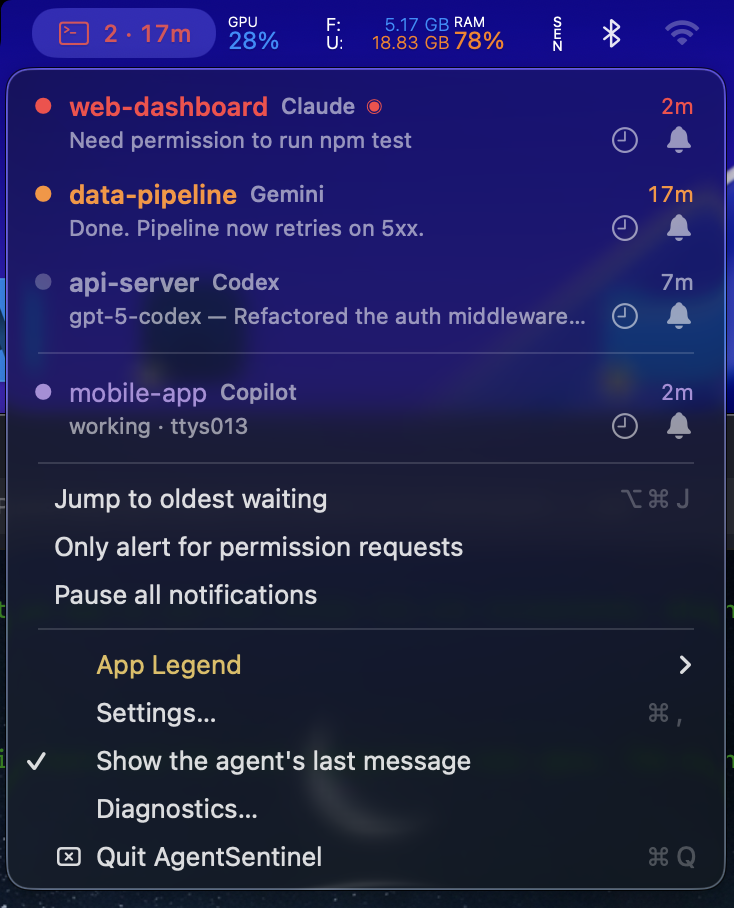
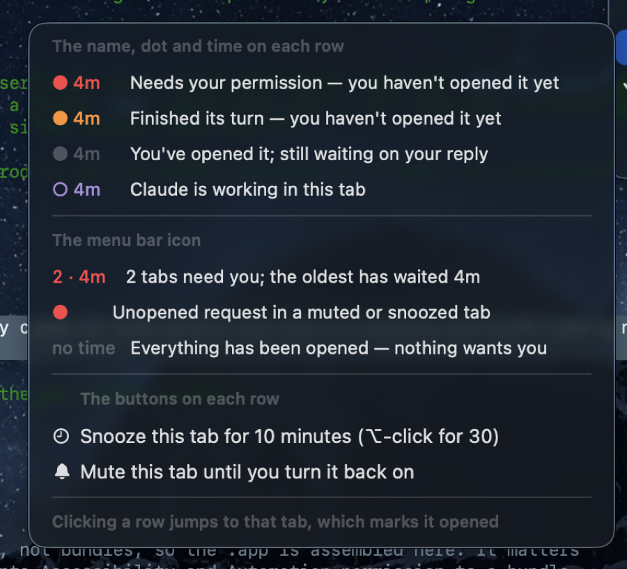

# TerminalNavigator

A macOS menu bar app that tells you which Claude Code sessions are waiting on you, and takes
you to the right terminal tab when you click one.

Run Claude Code in six tabs and the hard part stops being the work — it's noticing that one of
them has been sitting on a permission prompt for ten minutes while you watched a different one
think. This puts that in the menu bar.



Colour answers *have you dealt with this*, not *what is it doing* — and the menu explains
itself, so nobody has to memorise it:



Open a tab and its row goes quiet — the badge moves to the next one, and disappears once
nothing is left waiting on you.

## Requirements

- macOS 13 or later
- Terminal.app (iTerm2, Ghostty and others aren't supported yet — see [Adding a terminal](#adding-a-terminal))
- [Claude Code](https://claude.com/claude-code)
- Swift 5.9+ toolchain (Xcode or Command Line Tools)

## Install

```sh
git clone https://github.com/AyeKarimba/TerminalNavigator.git
cd TerminalNavigator
make install
```

That's it. It builds `TerminalNavigator.app`, installs it to `/Applications`, registers the
Claude Code hooks, starts it at login, and launches it. The `>_` icon appears in your menu bar.

To remove everything again:

```sh
make uninstall
```

<details>
<summary>What <code>make install</code> actually does</summary>

- Builds a release binary and assembles it into a proper `.app` bundle, ad-hoc signed. This is
  not cosmetic: macOS ties Accessibility and Automation permission to a bundle identity, and a
  bare binary run out of `.build` gets a new identity on every rebuild — so permissions
  silently lapse.
- Adds five hooks to `~/.claude/settings.json`, pointing at the `tnav` inside the bundle.
  It **merges**: any hooks you already have, including other tools' hooks on the same events,
  are left alone. A backup is written to `settings.json.tnav-backup`, and re-running replaces
  its own entries rather than duplicating them.
- Installs a LaunchAgent so it starts at login. Skip with `make install ARGS=--no-login`, or
  `./scripts/install.sh --no-login`.
- Installs to `~/Applications` instead if `/Applications` isn't writable.

`make uninstall` reverses all of it and leaves `~/.claude/tnav` in place so your mutes and
snoozes survive a reinstall; `./scripts/uninstall.sh --purge` removes that too.
</details>

Already-running Claude Code sessions appear at their next event — send a message in one and it
shows up. New sessions appear immediately.

### Permissions

macOS will ask for these the first time each is needed:

- **Automation** (Terminal) — required, to ask Terminal which tab a session is in.
- **Accessibility** — optional, to reach tabs on other desktops.

Open **Diagnostics…** from the menu to check hook registration and which focus backend is live.

## Known limitation: other desktops

**Clicking a tab on another desktop brings its window to you, instead of taking you to it.**

This is the honest state of the art, not an oversight. macOS offers no supported way for an app
to switch desktops:

| Route | Reaches the tab | Side effect |
|---|---|---|
| AppleScript | same desktop only | none |
| **Terminal's Window menu** (shipped) | always | brings the window to your desktop |
| Private window-server call | only with SIP disabled | **corrupts Spaces system-wide when SIP is on** |

The third was implemented, measured and removed. With System Integrity Protection enabled — the
default — `CGSManagedDisplaySetCurrentSpace` reports success and moves the window server's idea
of the current desktop while the display never changes, which breaks Mission Control and Stage
Manager machine-wide. Full measurements in
[`docs/phase1-spaces-finding.md`](docs/phase1-spaces-finding.md).

Refusing off-desktop jumps was also tried, and rejected: most tabs are usually on another
desktop, so it turned the app into a dialog box. Bringing the window to you is a nuisance, but a
visible and undoable one.

## Getting your attention

The badge is passive — fine if you glance at the menu bar, useless if you're deep in something
else. So a tab that starts waiting can also raise a banner, play a sound, and pulse the menu
bar icon. All of it is adjustable under **Settings…** (`⌘,`):

| | |
|---|---|
| **Banner** | on/off, three sizes, how long it stays, and whether it may appear over fullscreen apps |
| **Sound** | on/off, volume, and separate sounds for "waiting" and "needs permission" |
| **Pulse** | on/off, strength, and whether finished turns pulse or only permission requests |

Permission requests always pulse deeper and faster than finished turns — the difference between
*there's something for you* and *something is stuck* should be felt, not read.

Each request alerts **once**. If it's still unanswered after five minutes it escalates a single
time, at the urgent sound, and then goes quiet for good. Muting, snoozing, pausing, and the tab
you're already looking at all suppress alerts entirely.

The banner is the app's own window rather than a system notification, and that's a deliberate
trade. macOS fixes the size of a system notification and decides from your Focus settings
whether it may appear over a fullscreen app — an app gets no say in either. Making those two
adjustable required owning the window. The cost is that this banner does not respect Do Not
Disturb, which is why **show over fullscreen apps is off by default**: going fullscreen is often
precisely a request not to be interrupted.

## Usage

Click any row to jump to that tab, or click a banner to go straight to the tab that raised it.
The controls on each row snooze it for 10 minutes (⌥-click for 30) or mute that tab entirely.
`⌥⌘J` jumps to the oldest tab waiting on you.

There's also a CLI:

```sh
tnav list      # what's waiting, as text
tnav jump      # go to the oldest waiting tab
tnav spaces    # which tabs are on which desktop
tnav resolve   # explain how this tab was identified (debugging)
```

## How it works

Claude Code hooks fire on every session event. `tnav hook` resolves which terminal tab the
session belongs to by walking the process tree to its controlling TTY, then writes one JSON
file per session under `~/.claude/tnav/sessions/`. Those files are the entire contract: the
menu bar app can be closed, restarted or absent without state going wrong.

The app watches that directory, plus a Darwin notification the hook posts, plus a periodic
reload for the things neither can see — a tab closed, a tab switched to by hand, a config edit
from another process. End to end, a hook event reaches the menu in about 12ms.

`tab.tty` is the join key between a Claude session and a Terminal tab. It survives everything a
window title doesn't.

### Adding a terminal

Every terminal-specific call sits behind the `TabController` protocol
(`Sources/TNavCore/TabController.swift`). iTerm2 or Ghostty support means one new conformance;
the hook, state and UI layers don't change.

## Development

```sh
make test        # 130 unit tests
make check       # unit tests + the hook integration test
make run         # run from source, without installing
make app         # build the .app into ./build without installing
make clean
```

Note that `make run` uses the binary in `.build`, whose signature changes on every rebuild —
so macOS drops its Accessibility grant and cross-desktop jumps quietly stop working. That is a
property of unsigned local builds, not a bug. `make install` is the one that behaves
consistently.

Other tools:

```sh
python3 scripts/verify-focus.py                   # does a jump switch desktop, or pull the window?
./.build/debug/TerminalNavigatorApp --dump-menu   # render the menu as text
swift scripts/make-icon.swift                     # regenerate Resources/AppIcon.icns
```

`--dump-menu` exists because an `NSStatusItem` menu can't be opened from another process via
Accessibility, so it's the only way to assert on what the menu actually shows.

`verify-focus.py` reports whether each jump **switched desktop** or **pulled the window** — the
original version only checked the tab became frontmost, which is true either way, and that gap
hid the limitation above for some time.

Set `TNAV_STATE_DIR` to point any binary at a scratch state directory.

## Design notes

- [`docs/phase0-recon-findings.md`](docs/phase0-recon-findings.md) — the hook payload shapes,
  measured rather than assumed
- [`docs/phase1-spaces-finding.md`](docs/phase1-spaces-finding.md) — the Spaces investigation,
  including a correction to its own earlier conclusion

## License

MIT — see [LICENSE](LICENSE).
